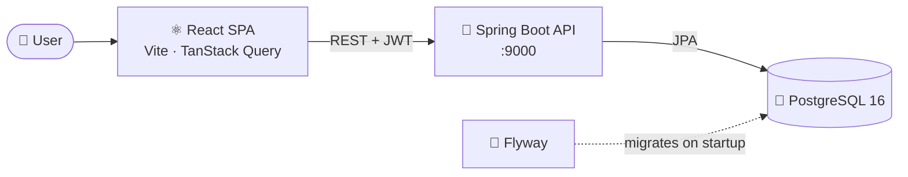

<div align="center">

# 🪺 Nido

### All your learning. One single place.

A personal study-notes app that replaces notes scattered across Google Docs and
Excalidraw with one focused workspace — simpler than Notion.


<br />


</div>

<!-- Screenshots: add images under docs/screenshots/ and reference them here, e.g.
<p align="center"></p>
-->

---

## ✨ Features

- 🗂️ **Spaces → topics → notes** — organize material into spaces, each with a nested
  tree of topics.
- 🌳 **Drag-and-drop topic tree** — reorder and reparent topics, and color-code them.
- 📝 **Block-based notes** — a Confluence-style editor (BlockNote) with debounced
  autosave and a live save status.
- 🔀 **Note tabs** — keep several notes open; tabs are remembered per space.
- ↩️ **Undo on delete** — deleting a space can be undone from a 5-second toast.
- 🌗 **Light and dark themes**.

## 🛠️ Tech stack

| Layer        | Technologies                                                                                       |
| ------------ | -------------------------------------------------------------------------------------------------- |
| **Frontend** | React 19, TypeScript, Vite, TanStack Query, React Router 7, shadcn/ui + Tailwind v4, react-hook-form + zod, BlockNote, dnd-kit |
| **Backend**  | Java 25, Spring Boot 4, Spring Security, Spring Data JPA, JJWT, Bean Validation                    |
| **Database** | PostgreSQL 16, Flyway migrations                                                                   |
| **DevOps**   | Docker, Docker Compose, GitHub Actions, GitHub Container Registry                                  |

## 🏗️ Architecture



```
nido/
├── backend/      # Spring Boot REST API (feature packages: auth, spaces, topic, note…)
├── frontend/     # React + TypeScript SPA
└── compose.yml   # Backend image, PostgreSQL and Adminer
```

## 💡 Engineering highlights

- 🔐 **Secure auth flow** — short-lived JWT access token kept in memory, refresh token in
  an `HttpOnly` cookie, and CSRF protection on the cookie-based endpoints.
- ⚡ **Optimistic UI** — topic create, rename, move, and delete update the tree instantly
  and roll back if the server rejects the change.
- 🧵 **Race-free autosave** — saves for the same note are serialized through a queue,
  and the server uses optimistic locking (a `version` column) to reject stale writes
  with `409 Conflict`.
- ♻️ **Soft deletes** — rows are marked with `deleted_at`, and uniqueness is enforced
  only on live rows with partial unique indexes.
- 🧬 **Versioned schema** — every change ships as a Flyway migration, and Hibernate
  validates the entities against it on startup (`ddl-auto: validate`).
- 🛡️ **Per-user isolation** — every endpoint checks that the resource belongs to the
  authenticated user.
- 🤖 **CI/CD** — the backend Docker image is built and published to GHCR on every push to
  `master`, and pull requests get an automated Claude Code review.

## 🚀 Getting started

### Prerequisites

- ☕ Java 25
- 📦 Node.js and [pnpm](https://pnpm.io/)
- 🐳 Docker

### 1. Start the database

Create a `.env` file in the repository root:

```env
POSTGRES_DB=nido
POSTGRES_USER=nido
POSTGRES_PASSWORD=change-me
```

```bash
docker compose up -d db
```

### 2. Run the backend

Export the variables the API reads:

```bash
export DB_HOST=localhost DB_PORT=5432 DB_NAME=nido
export DB_USERNAME=nido DB_PASSWORD=change-me
export JWT_SECRET=<a-long-random-secret>

cd backend
./mvnw spring-boot:run -Dspring-boot.run.profiles=dev
```

The API starts on `http://localhost:9000`, and Flyway applies the migrations automatically.

### 3. Run the frontend

```bash
cd frontend
echo "VITE_API_URL=http://localhost:9000" > .env
pnpm install
pnpm dev
```

Open **http://localhost:5173** 🎉

## 🗺️ Roadmap

- [ ] 🎨 Embedded Excalidraw diagrams inside notes
- [ ] 🧪 Broader automated test coverage

## 👤 Author

**Eduardo Reynoso** — [@EddieReynosoR](https://github.com/EddieReynosoR)
